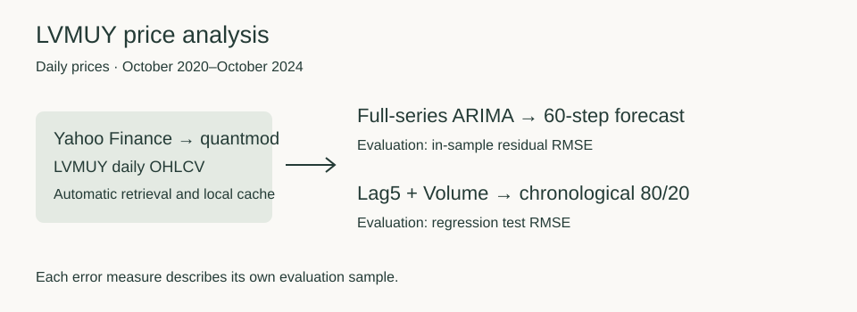

# LVMH Stock Price Forecasting

Exploratory time-series modeling of LVMUY closing prices, Purdue University, October–December 2024. Author: Chau Nguyen.

## Problem and methods
The project explores price trends, moving averages, ARIMA extrapolation and lagged-price regression. The retained source intends a four-year daily window (2020-10-23 to 2024-10-23), classical decomposition at frequency 360, 50/200-observation simple moving averages, automatic ARIMA on the full series, and a 60-step forecast. The regression formula is Close ~ Lag5 + Volume with an intended chronological 80/20 partition.



## Restoration status
The original input object and saved results are missing. Standalone execution was broken by an undefined variable, overwritten partitions and deleted lag columns. This repository repairs those implementation errors and requires an explicit authorized OHLCV file. It retains within-partition lag construction, so the first five rows of each partition are omitted.

No historical numerical performance is published. The CV describes a time-ordered ARIMA-versus-regression comparison; the retained code does not establish it. ARIMA residual RMSE and regression test RMSE use different evaluation samples and must not be ranked as a common holdout comparison. Same-day realized Volume is an explanatory input and may be unavailable at a prospective forecast origin. No investment or operational outcome is claimed.

## Reproduce a corrected run
```sh
Rscript setup.R
Rscript run_analysis.R /private/LVMUY.csv outputs
```
The script writes a multi-page figure PDF, metrics with explicit evaluation labels, private predictions and run metadata. See data/README.md. The original frequency=360 assumption is preserved rather than silently modernized. Source parsing and synthetic contract checks can be run without original data; those are not research reproduction.

## Files and provenance
`src/stock_analysis.R` contains input validation and the recovered analytical steps. `run_analysis.R` is the entry point. The unchanged original is retained privately. No dataset license or source license is inferred. The project is distinct from the supervised-autoencoder study.

[Executed validation](docs/VALIDATION.md) · [Portfolio case study](https://chau-nguyen-research.gabledmango1.chatgpt.site/lvmh.html)
